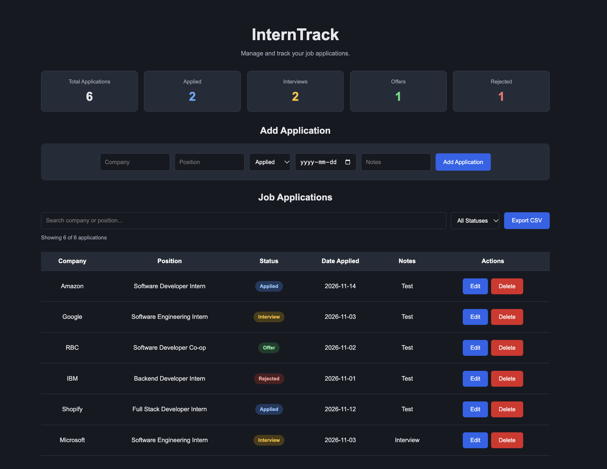

# InternTrack

InternTrack is a full-stack web application designed to help
students manage and track their internship and job applications
in one place.

## Screenshot



## Features

- Add, edit and delete job applications
- Track application statuses
- View application statistics through a dashboard
- Search applications by company or position
- Filter applications by status
- Export application records as a CSV file
- Store application data using a SQLite database
- Automated backend testing with Pytest
- Continuous integration using GitHub Actions
- Responsive dark-themed user interface

## Technologies Used

### Frontend

- React
- JavaScript
- HTML
- CSS
- Vite

### Backend

- Python
- Flask
- SQLite
- SQL
- REST APIs

### Development and Testing

- Git
- GitHub
- Pytest
- GitHub Actions

## System Architecture

The application uses a three-layer architecture:

- Frontend: React handles the user interface.
- Backend: Flask processes HTTP requests and application logic.
- Database: SQLite stores application records.

The frontend communicates with the backend through REST APIs
using JSON.

## API Endpoints

| Method | Endpoint | Description |
|--------|----------|-------------|
| GET | /applications | Retrieve all applications |
| POST | /applications | Create an application |
| PUT | /applications/:id | Update an application |
| DELETE | /applications/:id | Delete an application |
| GET | /applications/export | Export applications as CSV |

## Installation and Setup

### Prerequisites

- Python
- Node.js
- npm
- Git

### Backend Setup

Navigate to the backend folder:

```bash
cd backend
python3 -m venv venv
source venv/bin/activate
pip install -r requirements.txt
python app.py
```

The backend runs at:

http://127.0.0.1:8000

### Frontend Setup

Open a separate terminal from the project root:

```bash
cd frontend
npm install
npm run dev
```

The frontend runs at:

http://localhost:5173

## Automated Testing

To run the backend tests:

```bash
cd backend
source venv/bin/activate
python -m pytest -v
```

GitHub Actions automatically runs the backend tests when
changes are pushed to the repository.

## Future Improvements

- User authentication
- PostgreSQL database support
- Interview reminders
- Application progress charts
- Cloud deployment

## Author

Usaid Alam

Computer Science Student at Western University

## License

This project is licensed under the MIT License.